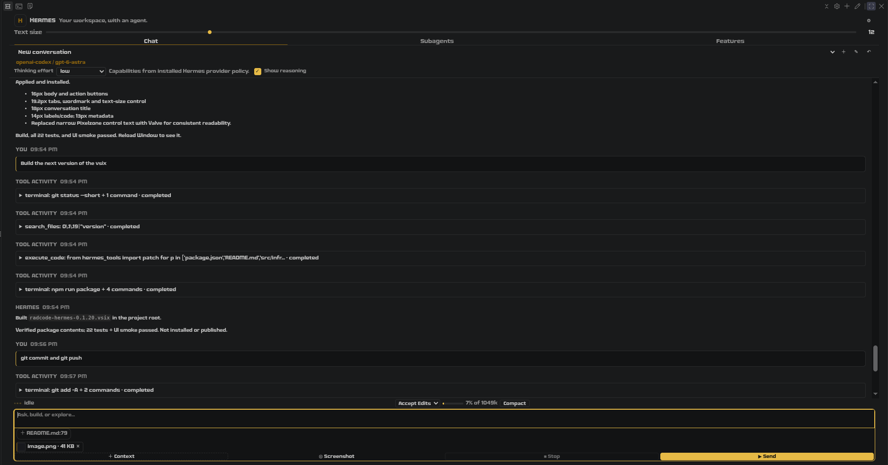

# PraeCode — Hermes Agent for VS Code

[](CHANGELOG.md)
[](LICENSE)
[](https://github.com/lainiceanuraduc/PraeCode)

PraeCode is an editor interface for an existing **Hermes Agent** installation. It brings chat,
model selection, attachments, approval prompts, saved conversations and worker sessions into
VS Code / VSCodium. **Hermes performs the underlying agent work**, including tool execution and
conversation storage; PraeCode connects to it over ACP (Agent Client Protocol).

This is an experimental, mostly AI-written project, not an independently audited product.
It can ask Hermes to run commands and modify files. Start in a disposable repository with approvals
set to **Ask**, and keep backups or version control.

## Basic workflow

1. Install and configure Hermes separately, then run `hermes acp --check` in a terminal.
2. Open a trusted local workspace and the PraeCode view. Connect and create a conversation.
3. Open the model picker and select a configured provider/model. Choose an available effort level
   and keep the approval mode on **Ask** while trying the extension.
4. Attach a small text file with **+ Context** and ask: “Summarize this file without changing it.”
5. For a controlled edit, ask for one small change in a disposable file. Review any approval request
   before allowing it, then inspect the actual Git diff. Whether a request is shown depends on
   Hermes' tools and approval policy; not every operation necessarily prompts.
6. Rename the conversation, reload the editor and try resuming it. See the recovery scope below
   before relying on it for important work.

This is a suggested acceptance walkthrough, **not a claim that a recorded end-to-end demonstration
or a compatibility certification exists**.



Release history, typography changes and historical fixes are in [CHANGELOG.md](CHANGELOG.md).

## Install and requirements

- An existing, configured Hermes installation with working ACP support. Check it with
  `hermes acp --check` before connecting.
- VS Code / VSCodium **1.96+** (the declared minimum, not a tested compatibility matrix).
- A trusted local workspace folder; untrusted workspaces are not supported.

**VS Code:** install `lainiceanuraduc.praecode` from the Marketplace:

```bash
code --install-extension lainiceanuraduc.praecode
```

**VSCodium or manual installation:** use *Extensions → … → Install from VSIX* with
`praecode-0.1.40.vsix`, or:

```bash
codium --install-extension ./praecode-0.1.40.vsix
```

**From source:** run `npm install && npm run compile`, then press **F5** to launch an Extension
Development Host. `npm run package` builds the VSIX. PraeCode does not bundle or install Hermes.

## Features

| Area | Interface |
|---|---|
| Chat | Streaming replies, sanitized Markdown, tool activity, cancellation and approval cards |
| Models | Provider/model picker, favorites, model details and route-specific effort controls |
| Context | Workspace text-file attachments; pasted images and screenshots depend on agent/model capabilities |
| Conversations | Rename and resume eligible saved sessions from the selected Hermes profile and workspace |
| Subagents | Hermes delegation policy and workspace-associated child runs, plus independent worker-session presets |
| Profile | Explicit read/save controls for `SOUL.md`, `memories/USER.md` and `memories/MEMORY.md` |
| Appearance | Accent, text-size, line-height and compact controls; resizable prompt |
| Diagnostics | The **PraeCode Hermes** output channel |

Worker presets live in VS Code global state. Running one creates a separate Hermes conversation,
not an isolated filesystem: workers share the workspace and Hermes profile, including tools and
credentials. Use separate worktrees if workers could edit the same files. These presets are distinct
from Hermes' native `delegate_task` policy; they do not configure that policy.

## Configuration, credentials and data flow

PraeCode is **not read-only with respect to the Hermes profile**. The relevant write paths are:

| Action | What changes |
|---|---|
| **+ Provider → Save** | The bundled Python bridge calls Hermes' `save_config(config, merge_existing=True)` to add/update the provider entry in the selected profile's `config.yaml` |
| Supplying an API key in that form | The bridge **directly writes** the key into the profile's `.env`, under a provider-derived variable such as `<ID>_API_KEY`; `config.yaml` receives the variable name in `key_env`, not the key value |
| **Features → Save** | The extension host writes the selected allowlisted profile file (`SOUL.md` or either memory file) |
| Session operations | Prompts, rename, effort changes and compaction are sent to Hermes; Hermes manages session state and transcripts |
| Editor preferences | Favorites, worker presets and appearance/index state are stored using VS Code state/settings |

The provider form necessarily handles the entered key in the webview and passes it through the
extension host to the bridge. It is not intended to persist the key in VS Code settings or extension
state. **That does not mean PraeCode never handles or writes credentials.** The bridge attempts to
set `.env` permissions to `0600`; permission-setting errors are currently suppressed, so this is not
a cross-platform guarantee. The file remains plaintext: protect the profile and do not commit it.

**Test** probes the supplied endpoint; **Save** persists the provider and then probes it. A failed
probe can leave a saved provider with a warning. A successful model-list probe does not establish
that chat or tools work through Hermes. Newly saved providers apply to newly created sessions.
Only send credentials to endpoints you trust.

Prompts, attached file contents and images may be sent to the selected model provider through Hermes.
The extension host validates attachment paths and reads file bytes at send time. There is no raw
`config.yaml` editor in Features, but the provider form above can modify that configuration.

## Saved conversations and recovery scope

Transcripts are stored by **Hermes**, not solely in the extension. PraeCode keeps an index and can
rebuild it from the selected profile's `state.db`, but this is **not a browser for every Hermes
conversation**:

- The bridge queries ACP sessions and local sessions marked as created through ACP, with at least
  one message, including archived sessions.
- It examines at most **500** recent candidate rows, filters by the workspace working-directory
  path, and returns at most **200** matching entries. This can include sessions from another ACP
  client; it is not limited strictly to sessions created by PraeCode.
- The host merges recovered entries with its saved index. That does not remove the database-query
  limits or make all history discoverable.
- Recovery after an update or reinstall depends on retaining the Hermes database, selecting the
  same profile and workspace path, and having a compatible Hermes runtime. A deleted profile,
  moved workspace or session outside the query scope may not be recovered automatically.

Keep backups of the Hermes profile if conversations matter. An extension reinstall is neither a
backup mechanism nor a guarantee of complete recovery.

## Models and thinking effort

Effort is **provider-route and model specific**. PraeCode asks its Hermes-side bridge for the levels,
shows the returned options, applies a selection through Hermes and reads back session state.
Some routes rely on Hermes policy or fallback metadata rather than a live per-model probe. A stored
setting is not, on its own, proof that the provider received or honored it.

For Mistral, the bundled ladder module reads a discovered cache first and uses its shipped table as
an offline seed. Discovery uses the provider's rejection response to identify accepted levels; the
cache expires after seven days. These are **entries in the shipped implementation**, not a promise
about future provider behavior:

| Mistral API model / group | Shipped effort levels |
|---|---|
| `mistral-large-4`, `mistral-large-4-0` | `low, medium, high` — **not `none/high`** |
| Listed Small / Medium / Magistral / Vibe reasoning models | `none, high` |
| `deepseek-v4-1-flash-1017` | `none, low, high, xhigh, max` |
| Listed GLM 5 / 5.3 models | `low, high, max` |
| `glm-5-2`, `zai-glm-5-2` | `none, minimal, low, medium, high, xhigh, max` |
| Listed non-reasoning models, including `mistral-large-latest` | Omit `reasoning_effort` entirely |

Exact IDs, family rules and cache behavior are in
`hermes-plugin/mistral/mistral_ladders.py`. The bridge and bundled provider plugin share that
implementation/cache design; an outdated installed plugin can still differ from the extension.
A model served through OpenRouter or another endpoint must use that route's policy, not blindly
inherit the Mistral API ladder.

For Hermes installations without the required Mistral provider profile, the repository includes
`hermes-plugin/mistral`. Install it into the **selected profile's** `plugins/model-providers/`
directory if needed; review the plugin before installing and restart the relevant Hermes process.
Without appropriate provider support, an effort setting may be stored without being sent on the wire.
The plugin is not automatically installed by the extension.

Provider compatibility depends on the installed Hermes version, model, endpoint and account access.
In particular, adding a local OpenAI-compatible endpoint is not a guarantee that its authentication,
reasoning or tool-calling behavior is supported. No comprehensive provider/platform matrix is certified.

## Mammouth AI

In the model picker, choose **+ Provider** and enter:

- **Provider id:** `mammouth`
- **Display name:** `Mammouth AI`
- **Base URL:** `https://api.mammouth.ai` or `https://api.mammouth.ai/v1`
- **API key:** your Mammouth API key, not a web-session cookie
- **Default model:** optional; a blank field uses `mammouth-recommended` if the catalog lists it,
  otherwise its first chat candidate.

Choose **Test**, then **Save**, and **open a new conversation**. Root URLs are normalized to `/v1`
for chat. Model discovery uses Mammouth's separate `/public/models` endpoint **without sending your
key**. Save imports those IDs as declared models in Hermes and pins the provider to Chat Completions,
so new ACP processes do not depend on an undocumented `/v1/models` endpoint or a Responses API.
Save again to refresh the imported catalog; no separate provider plugin is needed.

The public catalog includes non-chat models without a type field. PraeCode excludes recognizable
embedding/image/audio-generation names; this is a conservative name filter, **not per-model
verification of tool calling, vision or reasoning levels**. Test checks public discovery only: it
does not validate your key, balance or chat access. Chat consumes Mammouth **API credits**, not the
web app's message allowance. See Mammouth's [API quick start](https://info.mammouth.ai/docs/api-quick-start/)
and [catalog instructions](https://info.mammouth.ai/docs/openclaw/).

For this integration, public discovery was exercised live and save/catalog behavior was tested with
a temporary profile. **An authenticated Mammouth chat/tool turn has not been verified.**

## Reviewing changes Hermes already made

Under **Accept Edits** and **Don't Ask** there is no approval prompt, so an edit can land before you
look at it. PraeCode records those edits in a **Changes** panel above the transcript:

- **Review diff** opens a native editor diff (captured before ↔ proposed after) in read-only
  `praecode-review:` documents. The recorded snapshot is not the transcript: the transcript truncates
  tool content and replaces it with a text summary.
- **Keep** marks the entry reviewed. It changes no files and grants no tool permission.
- **Revert** is explicit, one file at a time, and refuses whenever the bytes on disk no longer match
  the recorded after-image, the editor has unsaved changes for that file, or any PraeCode turn or
  worker is running. Otherwise it writes the recorded before-image back through a temp file + rename;
  a new file is deleted instead. Nothing is reverted automatically.

What is and is not captured:

| Case | Recorded | Revert |
|---|---|---|
| Local ACP adapter: `write_file` / `patch` (replace) | complete before and after text | yes, hash-checked |
| Gateway: location-only edit (no diff in the event) | file text snapshot taken at the tool start, after-state read at completion | yes, only when the file changed exactly once |
| Two writes racing on one file in the same session | recorded, but unattributed | **no** — review only |
| Failed, cancelled or interrupted tool call | recorded as `unavailable` | **no** |
| Multi-file V4A patch | patch text, not a file image | **no** — review only |
| Shell/terminal edits, binary or >1 MiB files | not captured | **no** |
| Sessions loaded from history (replay) | ignored | n/a |

Limits worth knowing: this is a review journal, **not a backup and not a sandbox**. It stores up to
100 records / 16 MiB per profile in the extension's storage (`0600`), keeps at most 2 MiB per file,
never follows symlinks, and skips `.git`, `.ssh`, `.hermes`, `.env`, key and certificate paths. A
revert does not rewrite Hermes conversation history, and shell edits or unsupported patches must be
undone by you. Rollback is per file: for several edits to one file, revert newest first.

For review without reverting, **Hermes: Review Changes** in the command palette lists everything and
opens the same diff.

## Security notes that apply to 0.1.40

- **No credential ever follows a redirect.** Every outbound request goes through one helper that treats
  a 3xx as a failure, so an endpoint cannot `302` the `Authorization` header to another host.
- **Credential files are not attachable.** `.env` (except templates like `.env.example`), `.npmrc`,
  `.pypirc`, `.netrc`, `credentials.json`, `id_rsa`-family keys, `*.pem`/`*.key`/`*.p12`/`*.pfx`,
  `*.kdbx`, and anything under `.git`/`.ssh`/`.gnupg` are refused by the host, hidden from the picker
  and never offered as the active-editor chip — attachment contents are sent to the model provider.
- **Rollback verifies and writes through one descriptor.** `O_NOFOLLOW` + `ftruncate`/`write` on the
  opened file, with an inode re-check afterwards: a symlink, a hardlink or a swapped path is refused
  rather than followed.
- **The Hermes launcher is data, not a command line.** The `--print-runtime-command` output is
  validated (absolute interpreter that exists, exact `-I -c` shape, no control characters) and the
  bridge directory is passed in the environment instead of being pasted into the Python source.
- **The provider `.env` write is atomic**, created `0600` and renamed into place; a key containing a
  line break is refused.
- The webview keeps its CSP (`default-src 'none'`), sanitized Markdown and path-only attachments.

## Code layout (0.1.40)

```
src/extension.ts                    activate/deactivate
src/extension/RadCodeExtension.ts   composition root (~220 lines), implements ExtensionHost
src/extension/host.ts               the interface commands/handlers receive
src/extension/commands/             SessionCommands, ModelCommands, WorkspaceCommands, register()
src/extension/handlers/             one module per webview domain + mergeHandlers (no duplicates)
src/state/                          Recents (workspace index), publish (the state object)
src/extension/review/               DiffDocuments (read-only diff URIs), revertGuard
src/domain/                         rules only: limits, ladders, drafts, launcher validation
src/application/                    SessionController
src/infrastructure/                 ACP transport/client, Hermes control, ChangeJournal
bridge/control.py                   dispatcher (~200 lines), one action per invocation
bridge/discovery/                   ladders, routes, effort catalog, model facts
bridge/provider_save/               endpoint rules, model-list probe, Hermes config write
bridge/sessions/                    resume listing (bounded)
bridge/delegation/                  delegation policy + child runs
bridge/rpc/                         fenced session RPC
bridge/net.py                       one-shot HTTP that refuses redirects
```

## Settings

| Setting | Default | Purpose |
|---|---|---|
| `radcode.hermesPath` | `hermes` | Hermes executable; auto-detects `~/.local/bin/hermes` when left at the default |
| `radcode.hermesHome` | *(empty)* | Absolute `HERMES_HOME` for a specific profile |
| `radcode.pythonPath` | *(empty)* | Hermes' Python interpreter if runtime-command discovery is unavailable; do not use an unrelated Python |
| `radcode.maxParallelAgents` | `2` | Maximum concurrent PraeCode worker sessions |
| `radcode.accent` | `yellow` | Highlight palette |
| `radcode.fontSize` | `10` | Base size in px (1–30); body text uses base + 1, with separate control sizes and width-dependent caps |
| `radcode.lineHeight` | `0` | Line-height multiplier; `0` follows the editor |
| `radcode.compact` | `false` | Tighter spacing |

## Security and limitations

- Commands execute with the editor/Hermes environment and its filesystem permissions. Workspace
  trust and approval UI are not a sandbox. Review proposed operations and their resulting diffs.
- **Accept Edits** and **Don't Ask** can reduce approval prompts according to Hermes' policy. Use
  **Ask** initially; neither mode names nor passing UI tests establish safe enforcement of all tools.
- The webview uses a restrictive CSP and DOMPurify for Markdown. Host-side message and attachment
  validation are defenses, not proof that hostile inputs cannot exploit the extension.
- Profile saves, provider credentials, permission resolution and file-operation boundaries deserve
  independent review. **No independent security audit has been completed.**
- Saved-session recovery is bounded as described above; worker sessions share files and profile state.
- File attachments are text-only; binary files are refused. Images use a separate capability-dependent
  path. File picking searches names, not contents.
- No voice, image-generation, general session-search UI or full Hermes administration interface.
  Advanced controls depend on a compatible local Hermes runtime.

## AI authorship and verification status

**Almost all implementation was written by AI agents, largely through Hermes Agent**, directed by
natural-language instructions, screenshots and human corrections. The author chose the behavior and
reviewed results but did not personally write most of the code. This disclosure is neither evidence
of safety nor a substitute for reviewing the implementation.

Development has included unit tests, Python bridge tests, Playwright UI smoke tests and selected
live ACP/provider probes. For 0.1.40: compilation is clean; **73 TypeScript tests**, the UI smoke
suite, and **53 Python bridge tests** pass (the Python suite was red with 10 stale Mistral
expectations before this release and is green now). Public Mammouth discovery and a real
temporary-profile save followed by a fresh-process ACP catalog read also passed. These are
developer-run checks, not independent verification; no authenticated Mammouth chat/tool turn was
exercised.

**The extension-host harness did not run here.** It now writes `docs/extension-host-result.json` and
fails loudly instead of exiting 0 silently, but under this headless runner the editor window exits
before the test host boots, so **no host-level run is claimed**. `vscode.diff` opening and the modal
revert confirmation are therefore still unexercised end to end; their decisions (diff URIs, snapshot
bounds, every revert refusal) are unit tested instead. Try both on a disposable file.

The change-review logic is tested against synthetic and Hermes-shaped ACP payloads, and the gateway
payload shape was confirmed from the installed Hermes source. **The editor-side diff tab
(`vscode.diff`) and the modal revert confirmation were not exercised by an automated run** — the
extension-host harness produces no verdict in this environment — and **no real agent-driven edit was
reverted end to end**. Try it on a disposable file before trusting rollback.

The full Python suite currently has **10 failing tests**, also reproduced unchanged at the previous
commit (44 tests before this change, 51 after). These are existing Mistral expectations, not passing
coverage. The new Mammouth tests add no failures; the broader suite is **not green**.

A handshake demonstrates connectivity, not safe file editing. A fixture-based UI test demonstrates
behavior under its supplied state, not reliable recovery from every real database. Neither establishes
compatibility across operating systems, editor versions, Hermes releases or providers. The editor-host
harness has not produced conclusive results in the development environment. There is no comprehensive
end-to-end certification or independent code review to cite.

Before relying on PraeCode, repeat the basic workflow in your environment, including approval denial,
file-diff inspection and recovery after reload. Bug reports should include versions and reproducible
steps, with credentials and private content removed. The project is MIT-licensed, provided **as is**
without warranty.

## Development and tests

```bash
npm install
npm run compile       # TypeScript check + bundles
npm test              # unit tests
npm run test:python   # bridge tests; requires the Hermes Python environment
npm run test:ui       # Playwright UI smoke tests; requires its Chromium installation
npm run test:live     # live ACP probe; requires a configured Hermes installation
npm run package       # builds praecode-0.1.40.vsix
```

Live checks can create sessions or contact providers. Inspect scripts and use a test profile/workspace
before running them. Test output describes that run only; the presence of a script is not a passing result.

The source is split into `domain/` (rules), `application/` (sessions), `infrastructure/` (ACP and
bridge transport), `extension/` (editor integration and validation), `presentation/` (webview host)
and `webview/` (UI). `bridge/control.py` performs Hermes-side operations, including provider saves;
`hermes-plugin/mistral/` contains the optional provider plugin. UI assets live under `media/`.

## Fonts and licensing history

The current UI uses Anklepants for titles, Not Jam Mono Clean 13 for controls and Kubasta for reading
text. Provenance and license evidence are included in `media/fonts/*.LICENSE.txt`; Kubasta's file
records the discrepancy between its author's CC0 statement and its embedded “Open Font License”
metadata. Some glyphs use system fallbacks, and italic text is browser-synthesized.

Earlier releases through 0.1.22 bundled Valve under a desktop-only license that did not permit this
use. It was removed in **0.1.23**; **0.1.24** renamed the project to PraeCode. That mistake remains
disclosed here rather than being erased from the project's history. See [CHANGELOG.md](CHANGELOG.md)
and [PUBLISHING.md](PUBLISHING.md) for the release and remediation record.
